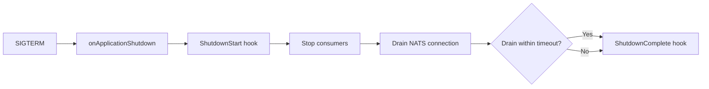

# Graceful Shutdown

> **Use when:** you are working out what a rolling deploy does to messages in flight.
> **You get:** the shutdown sequence, the drain timeout, and why redelivery is the guarantee instead of waiting.

The transport shuts down through the NestJS application lifecycle: consumption stops, then the connection drains, and whatever was in flight comes back through redelivery. You write no shutdown code beyond enabling the hooks.

## Enabling shutdown hooks

NestJS runs `onApplicationShutdown()` on SIGTERM and SIGINT only after you call `enableShutdownHooks()` in `main.ts`, as the [quick start](/docs/getting-started/quick-start) does:

```typescript title="src/main.ts"
app.enableShutdownHooks();
```

:::warning Without enableShutdownHooks(), shutdown is not graceful
The process dies on the signal without calling `onApplicationShutdown()`, and the NATS connection drops abruptly. JetStream still redelivers in-flight messages once `ack_wait` expires, so you lose nothing, but the exit is not clean.
:::

## How it works

`JetstreamModule` implements `OnApplicationShutdown`. On a termination signal it runs:

1. **`ShutdownStart` hook.**
2. **Stop consumers**: `strategy.close()` closes the consumer iterators and tears down the routing pipeline, so no new messages are taken.
3. **Drain the connection**: `nc.drain()` stops the subscriptions, flushes pending publishes and closes the connection.
4. **Safety timeout**: a drain that has not finished within `shutdownTimeout` is abandoned and shutdown goes on, so a stuck connection cannot block the process.
5. **`ShutdownComplete` hook.**



:::warning Handlers are not awaited
Stopping consumers tears down the routing pipeline, so a handler that is mid-execution is abandoned, not awaited. Its message never gets an ack, and JetStream redelivers it once the consumer's `ack_wait` expires. Delivery stays at-least-once and you lose nothing, but a handler running at SIGTERM runs again on another instance.

Keep handlers short and idempotent. If a unit of work must run only once, make it resumable or guard it with an idempotency key; do not rely on shutdown to let it finish.
:::

## Configuring the timeout

`shutdownTimeout` bounds the drain. The default is **10 seconds** (10,000 ms).

```typescript title="src/app.module.ts"
JetstreamModule.forRoot({
  name: 'orders',
  servers: ['nats://localhost:4222'],
  shutdownTimeout: 30_000,
})
```

The budget covers the connection drain, not handler execution, so it does not need to exceed your slowest handler. Raise it only if drains hit the ceiling against a slow or degraded cluster. When it fires, the transport closes the connection at once and JetStream redelivers anything unacked after `ack_wait`.

During a rolling deploy, `ack_wait` (not this timeout) decides when a message abandoned at SIGTERM becomes available to another instance.

## Multiple connections

With [connections](/docs/guides/multi-connection), shutdown runs in two phases instead of draining one connection at a time:

1. **Every** connection stops accepting new messages.
2. **Then** every connection drains in parallel, each bounded by its own `shutdownTimeout`.

Draining one by one would let a connection keep taking work while its peers are already winding down. The ceiling for the whole SIGTERM is `max(timeouts)`, not their sum. A connection that throws while draining does not stop the others from closing. A connection that never connected has nothing to drain and is skipped.

```typescript
JetstreamModule.forRoot({
  name: 'orders',
  defaultConnection: 'primary',
  shutdownTimeout: 10_000,             // fallback for connections that set none
  connections: {
    primary: { servers: ['nats://primary:4222'], shutdownTimeout: 30_000 },
    analytics: { servers: ['nats://analytics:4222'], shutdownTimeout: 5_000 },
  },
})
```

The worst case above is 30 seconds, not 35.

## Observing shutdown with hooks

`ShutdownStart` and `ShutdownComplete` serve logging and metrics:

```typescript
hooks: {
  [TransportEvent.ShutdownStart]: () => console.log('NATS transport shutting down...'),
  [TransportEvent.ShutdownComplete]: () => console.log('NATS transport shutdown complete'),
},
```

See [Lifecycle Hooks](/docs/guides/lifecycle-hooks) for all events.

## See also

- [Dead Letter Queue](/docs/guides/dead-letter-queue): what happens when a handler fails its final delivery attempt
- [Default Configs](/docs/reference/default-configs): the `ack_wait` each consumer starts with
