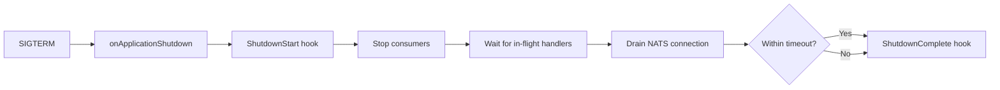

# Graceful Shutdown

> **Use when:** you are working out what a rolling deploy does to messages in flight.
> **You get:** the shutdown sequence, what happens to handlers still running, and the shutdown budget.

The transport shuts down through the NestJS application lifecycle: consumption stops, handlers already running finish and settle their messages, then the connection drains. You write no shutdown code beyond enabling the hooks.

## Enabling shutdown hooks

NestJS runs `onApplicationShutdown()` on SIGTERM and SIGINT only after you call `enableShutdownHooks()` in `main.ts`, as the [quick start](/docs/getting-started/quick-start) does:

```typescript title="src/main.ts"
app.enableShutdownHooks();
```

:::warning Without enableShutdownHooks(), shutdown is not graceful
The process dies on the signal without calling `onApplicationShutdown()`, and the NATS connection drops abruptly. JetStream still redelivers in-flight messages once `ack_wait` expires, so you lose nothing, but the exit is not clean.
:::

## How it works

`JetstreamModule` implements `OnApplicationShutdown`. On a termination signal it runs:

1. **`ShutdownStart` hook.**
2. **Stop consumers**: `strategy.close()` closes the consumer iterators and the Core RPC subscription, so no new messages are taken. Messages fetched but still waiting for a [concurrency](/docs/guides/performance) slot are handed back to the server with a `nak`, so another instance picks them up at once.
3. **Wait for in-flight handlers**: handlers that were already running finish, and their outcome is settled as usual: the event is acked or retried, the JetStream RPC command is acked and the caller gets its reply, the Core RPC request is answered.
4. **Drain the connection**: `nc.drain()` stops the subscriptions, flushes pending publishes and closes the connection.
5. **Safety timeout**: steps 3 and 4 share one `shutdownTimeout` budget. The drain always keeps the last part of it, half the budget but at most 2 seconds, so handlers wait at most `shutdownTimeout` minus that reserve. A drain still running when the whole budget is spent is cut short by closing the connection, so a hung handler or a stuck connection cannot block the process.
6. **`ShutdownComplete` hook.**



:::warning Handlers that outlast the budget
A handler still running when its share of the budget runs out is not awaited any further, and anything it publishes after the connection closes is lost. Its `emit()` and `send()` calls fail; none of them opens a new connection, and one that would have to dial rejects with `JetstreamConnectionError` and reason `shutting-down`. Its message never gets an ack, and JetStream redelivers it once the consumer's `ack_wait` expires, so the handler runs again on another instance. If that was the message's final delivery, it goes to the [dead letter queue](/docs/guides/dead-letter-queue#deliveries-no-handler-settled) instead. A JetStream RPC command is delivered only once, so its caller gets no reply and times out.

A JetStream RPC handler that is already past its own `rpc.timeout` is not waited for: the command was terminated at the deadline.

Delivery stays at-least-once. Keep handlers idempotent, and set `shutdownTimeout` above your slowest handler so a rolling deploy does not cut one off.
:::

NestJS calls `onModuleDestroy()` on every provider before the transport stops consuming, and handlers finish later, during `onApplicationShutdown()`. A handler that needs a resource, such as a database pool, must find it still open: release such resources in `onApplicationShutdown()` or later, not in `onModuleDestroy()`.

## Configuring the timeout

`shutdownTimeout` bounds the wait for in-flight handlers and the drain together. The default is **10 seconds** (10,000 ms).

```typescript title="src/app.module.ts"
JetstreamModule.forRoot({
  name: 'orders',
  servers: ['nats://localhost:4222'],
  shutdownTimeout: 30_000,
})
```

Set it above your slowest handler plus the drain reserve: 2 seconds, or half the budget below 4 seconds. When it runs out, the connection is closed and JetStream redelivers anything unacked after `ack_wait`. Keep it below the grace period of your orchestrator (`terminationGracePeriodSeconds` in Kubernetes, 30 seconds by default), or the process is killed before shutdown completes.

During a rolling deploy, `ack_wait` (not this timeout) decides when a message cut off at SIGTERM becomes available to another instance.

## Multiple connections

With [connections](/docs/guides/multi-connection), shutdown runs in two phases instead of draining one connection at a time:

1. **Every** connection stops accepting new messages.
2. **Then** every connection waits for its in-flight handlers and drains, in parallel, each bounded by its own `shutdownTimeout`.

Draining one by one would let a connection keep taking work while its peers are already winding down. The ceiling for the whole SIGTERM is `max(timeouts)`, not their sum. A connection that throws while draining does not stop the others from closing. A connection that never connected has nothing to drain and is skipped.

```typescript
JetstreamModule.forRoot({
  name: 'orders',
  defaultConnection: 'primary',
  shutdownTimeout: 10_000,             // fallback for connections that set none
  connections: {
    primary: { servers: ['nats://primary:4222'], shutdownTimeout: 30_000 },
    analytics: { servers: ['nats://analytics:4222'], shutdownTimeout: 5_000 },
  },
})
```

The worst case above is 30 seconds, not 35.

## Observing shutdown with hooks

`ShutdownStart` and `ShutdownComplete` serve logging and metrics:

```typescript
hooks: {
  [TransportEvent.ShutdownStart]: () => console.log('NATS transport shutting down...'),
  [TransportEvent.ShutdownComplete]: () => console.log('NATS transport shutdown complete'),
},
```

See [Lifecycle Hooks](/docs/guides/lifecycle-hooks) for all events.

## See also

- [Dead Letter Queue](/docs/guides/dead-letter-queue): what happens when a handler fails its final delivery attempt
- [Default Configs](/docs/reference/default-configs): the `ack_wait` each consumer starts with
