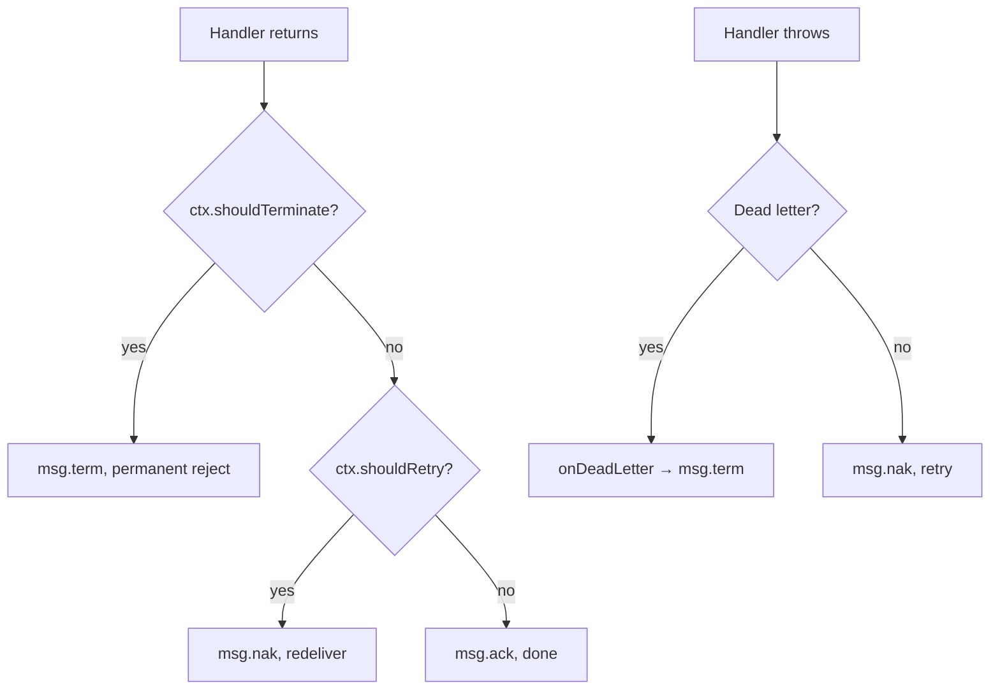

# Handler Context

> **Use when:** a handler needs the message metadata, the delivery count or manual control over settlement.
> **You get:** `RpcContext`, its getters, and the settlement methods to call instead of `msg.ack()`.

## Injecting the context

Every `@EventPattern` and `@MessagePattern` handler can take it through the standard NestJS `@Ctx()` decorator:

```typescript
import { Controller } from '@nestjs/common';
import { EventPattern, Payload, Ctx } from '@nestjs/microservices';
import { RpcContext } from '@horizon-republic/nestjs-jetstream';

@Controller()
export class OrdersController {
  @EventPattern('order.created')
  async handleOrderCreated(
    @Payload() data: OrderCreatedDto,
    @Ctx() ctx: RpcContext,
  ) {
    const subject = ctx.getSubject();
    const tenant = ctx.getHeader('x-tenant');
    // ...
  }
}
```

## Methods reference

### Message accessors

```typescript
class RpcContext {
  /** NATS subject this message was published to. */
  getSubject(): string;

  /** Value of a single header, or undefined if missing. */
  getHeader(key: string): string | undefined;

  /** All NATS message headers (raw MsgHdrs from @nats-io/transport-node). */
  getHeaders(): MsgHdrs | undefined;

  /** Type guard, true when the message is a JetStream message. */
  isJetStream(): boolean;

  /**
   * The raw NATS message. Narrowed to JsMsg after a successful isJetStream()
   * check, or Msg when the check returns false.
   */
  getMessage(): JsMsg | Msg;
}
```

### JetStream message info

These return `undefined` for Core NATS messages: no type guard needed.

```typescript
class RpcContext {
  /** How many times this message has been delivered. */
  getDeliveryCount(): number | undefined;

  /** The JetStream stream name. */
  getStream(): string | undefined;

  /** Stream sequence number. */
  getSequence(): number | undefined;

  /** Message publish timestamp. */
  getTimestamp(): Date | undefined;

  /** Name of the service that sent the message. */
  getCallerName(): string | undefined;
}
```

### Settlement actions

```typescript
class RpcContext {
  /** Redeliver the message (nak) instead of acknowledging it. */
  retry(opts?: { delayMs?: number }): void;

  /** Reject the message permanently (term), with no retry and no dead letter. */
  terminate(reason?: string): void;
}
```

Both throw on a Core NATS message. See [Controlling message settlement](#controlling-message-settlement).

## Accessing JetStream metadata

```typescript
@EventPattern('order.created')
async handle(@Payload() data: OrderCreatedDto, @Ctx() ctx: RpcContext) {
  console.log('Attempt:', ctx.getDeliveryCount());    // 1, 2, 3...
  console.log('Stream:', ctx.getStream());             // 'orders__microservice_ev-stream'
  console.log('Sequence:', ctx.getSequence());         // 42
  console.log('Published:', ctx.getTimestamp());       // Date object
  console.log('From:', ctx.getCallerName());           // 'api-gateway__microservice'
}
```

`getDeliveryCount()` drives fallback logic on retries:

```typescript
@EventPattern('payment.process')
async handle(@Payload() data: PaymentDto, @Ctx() ctx: RpcContext) {
  const attempt = ctx.getDeliveryCount() ?? 0;

  if (attempt >= 3) {
    // 3rd attempt, try a different payment provider
    await this.fallbackProvider.process(data);
    return;
  }

  await this.primaryProvider.process(data);
}
```

## Controlling message settlement

The transport acks when the handler returns and naks when it throws. `retry()` and `terminate()` override that without throwing:

| Call                      | Settles as                           | Use for                                                             |
| ------------------------- | ------------------------------------ | ------------------------------------------------------------------- |
| nothing                   | `msg.ack()`                          | the default after a successful return                               |
| `ctx.retry({ delayMs? })` | `msg.nak(delay)`, redelivery         | business retries: a dependency is unavailable, a resource is locked |
| `ctx.terminate(reason?)`  | `msg.term(reason)`, permanent reject | messages that are no longer relevant: the order was cancelled       |

Each retry consumes a delivery attempt. A `retry()` on the final permitted delivery goes through [dead-letter handling](/docs/guides/dead-letter-queue) like a throwing handler, so the message is captured instead of stranded.

### Business retry

When the message cannot be processed now but can be later:

```typescript
@EventPattern('order.fulfill')
async handle(@Payload() data: FulfillDto, @Ctx() ctx: RpcContext) {
  if (!await this.inventoryService.isAvailable()) {
    ctx.retry({ delayMs: 30_000 }); // try again in 30 seconds
    return;
  }

  await this.fulfillOrder(data);
  // auto-ack, no flags set
}
```

Without `delayMs`, the delay comes from the stream's retry curve, the same one a throwing handler uses (`[2000, 10000]` ms by default, see [`events.retry`](/docs/reference/module-configuration#retry)). With `retry: false` the redelivery is immediate.

### Terminate

When the message is no longer relevant and must not be retried or dead-lettered:

```typescript
@EventPattern('order.process')
async handle(@Payload() data: OrderDto, @Ctx() ctx: RpcContext) {
  const order = await this.orderService.find(data.orderId);

  if (order.status === 'cancelled') {
    ctx.terminate('Order already cancelled');
    return;
  }

  await this.process(order);
}
```

### Settlement decision flow



:::warning Mutual exclusivity
`retry()` and `terminate()` cannot both be called in the same handler; the second call throws an `Error`. Choose one intent per message.
:::

:::note Scope
Settlement actions only affect **JetStream event handlers** ([workqueue](/docs/patterns/events) and [broadcast](/docs/patterns/broadcast)). [Ordered events](/docs/patterns/ordered-events) are auto-acknowledged and log a warning when either is called. [RPC handlers](/docs/patterns/rpc) settle by their own rules.
:::

## Extracting custom headers

Headers set via [`JetstreamRecordBuilder.setHeader()`](./record-builder.md) are available through `getHeader()`:

```typescript title="Publisher"
const record = new JetstreamRecordBuilder(data)
  .setHeader('x-tenant', 'acme')
  .setHeader('x-trace-id', crypto.randomUUID())
  .build();

await lastValueFrom(this.client.emit('order.created', record));
```

```typescript title="Handler"
@EventPattern('order.created')
async handle(@Payload() data: OrderCreatedDto, @Ctx() ctx: RpcContext) {
  const tenant = ctx.getHeader('x-tenant');     // 'acme'
  const traceId = ctx.getHeader('x-trace-id');  // uuid string
  const missing = ctx.getHeader('x-unknown');    // undefined
}
```

## The `isJetStream()` type guard

`RpcContext` wraps either a JetStream message (`JsMsg`) or a Core NATS message (`Msg`, from Core RPC mode). `isJetStream()` narrows the return type of `getMessage()`:

```typescript
if (ctx.isJetStream()) {
  const msg = ctx.getMessage(); // TypeScript knows this is JsMsg
  console.log('Redelivered:', msg.redelivered);
}
```

## Accessing the raw NATS message

`getMessage()` returns the underlying NATS message. Prefer the typed accessors when they cover what you need.

```typescript
if (ctx.isJetStream()) {
  const msg = ctx.getMessage();
  console.log('Pending:', msg.info.pending);
  console.log('Stream sequence:', msg.info.streamSequence);
}
```

:::warning Manual acknowledgment
Calling `msg.ack()`, `msg.nak()`, or `msg.term()` directly bypasses the transport's settlement logic. Use `ctx.retry()` and `ctx.terminate()` instead: those run through ack extension, dead letter handling and the observability hooks.
:::

## See also

- [Record Builder & Deduplication](./record-builder.md): set headers and message IDs on the publisher side
- [Custom Codec](./custom-codec.md): control how the `@Payload()` data is serialized
- [Dead Letter Queue](./dead-letter-queue.md): what happens when retries are exhausted
- [Troubleshooting](./troubleshooting.md): common issues with message delivery
