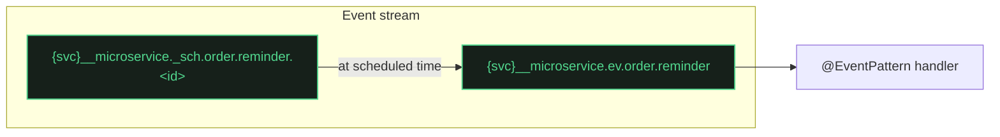

# How to schedule delayed messages

> **Use when:** an event should reach its handler later instead of now.
> **You get:** one-shot delayed delivery through NATS message scheduling, and the limits around it.

`scheduleAt()` publishes an event now and NATS delivers it at the given time ([ADR-51](https://github.com/nats-io/nats-architecture-and-design/blob/main/adr/ADR-51.md)). It needs NATS 2.12 and `allow_msg_schedules: true` on the target stream. For delays past the stream's `max_age`, recurring jobs or a schedule you can cancel, see the [overview](./scheduling-overview).

## Enable it on the stream

```typescript
JetstreamModule.forRoot({
  name: 'orders',
  servers: ['nats://localhost:4222'],
  events: {
    stream: { allow_msg_schedules: true },
  },
});
```

The flag is off by default. Turning it on is a regular stream update, without recreation or downtime, and it can never be turned off again. Broadcasts need the same flag on `broadcast.stream`.

## Schedule an event

```typescript
import { JetstreamRecordBuilder } from '@horizon-republic/nestjs-jetstream';
import { lastValueFrom } from 'rxjs';

const record = new JetstreamRecordBuilder({ orderId: 42, type: 'reminder' })
  .scheduleAt(new Date(Date.now() + 60 * 60 * 1000)) // in one hour
  .build();

await lastValueFrom(this.client.emit('order.reminder', record));
```

The handler is an ordinary `@EventPattern('order.reminder')` and runs at the scheduled time.

## How it works

The transport publishes the record to a unique subject under `{service}__microservice._sch.` in the same stream, with the `Nats-Schedule` and `Nats-Schedule-Target` headers. NATS keeps one pending schedule per subject, so a shared subject would let each publish replace the previous one. At the scheduled time NATS publishes a new message to the event subject and deletes the holder, and the consumer handles it like any event.



With a custom `subjectPrefix` the holders live under `{prefix}_sch.`, and an externally managed stream must capture that prefix. See [scheduling with a custom prefix](/docs/guides/external-infrastructure#scheduling-with-a-custom-prefix).

## `max_age` bounds the delay

The pending schedule is a stored message. If the stream's `max_age` runs out before the delivery time, NATS deletes it with neither a delivery nor an error. The default `max_age` is 7 days for events and 1 hour for broadcasts.

For a longer delay, use [`client.schedule()` with `{ at }`](./recurring-schedules#schedules-from-a-client): it lives in a stream with no `max_age`. Raising the events stream's `max_age` also works, but it keeps every other event for that long too.

## Limitations

- **Events and broadcasts only.** For RPC (`client.send()`) the transport logs a warning and ignores `scheduleAt()`. For [`ordered:` patterns](/docs/patterns/ordered-events) it throws, because NATS needs the holder and its target in the same stream.
- **Future dates only.** A date that is not in the future throws.
- **Server version.** On a server older than 2.12, `scheduleAt()` and `allow_msg_schedules` throw a `JetstreamCapabilityError`. Such servers accept the flag and never fire the schedule.
- **`ttl()` starts at delivery.** Combined with `scheduleAt()`, the TTL is sent as `Nats-Schedule-TTL` and counts from the moment the schedule fires.

## See also

- [Record builder](/docs/guides/record-builder): the rest of the builder API
- [Message TTL](./per-message-ttl): expiry per message
- [Default configs](/docs/reference/default-configs#enable-only-can-be-turned-on-but-never-off): `allow_msg_schedules` among the enable-only properties
