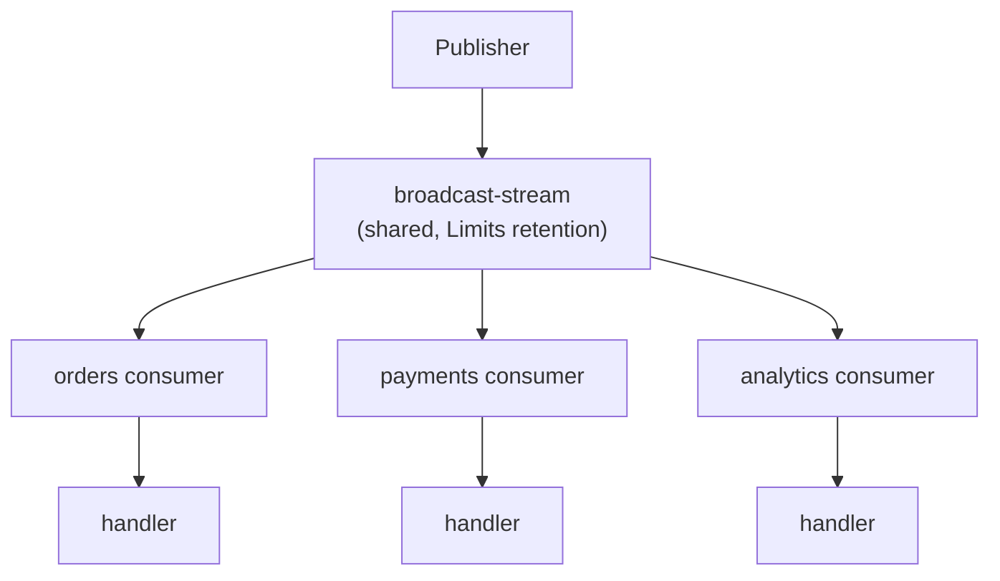
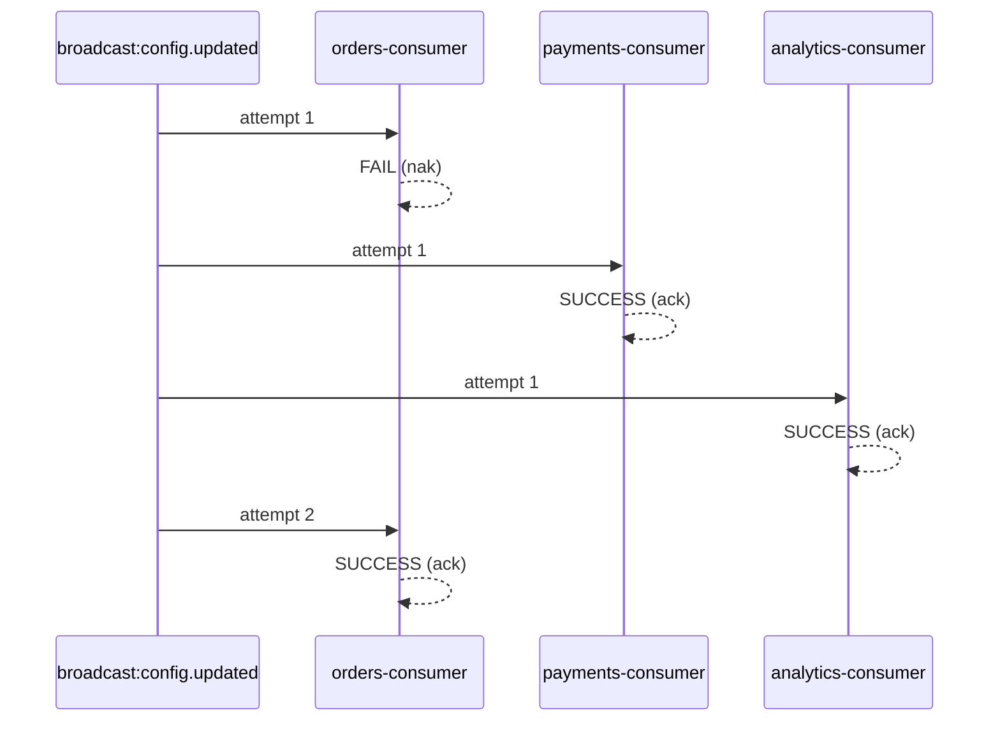

# Broadcast Events

> **Use when:** every running service must react to the same message (cache invalidation, feature-flag flips, config reload).
> **You get:** per-service durable consumers on a shared stream, late-joining replicas catch up automatically.

A broadcast event **fans out**: every service with a matching handler gets its own copy. A [workqueue event](/docs/patterns/events) reaches one instance, and an [ordered event](/docs/patterns/ordered-events) gives each instance a sequential replay.

A typical case: a feature flag changes, and orders, payments and notifications all have to refresh their local cache. Calling each service does not scale, and a workqueue event would reach only one of them.

## How it works

1. **Publish**: a service calls `client.emit('broadcast:config.updated', data)`. The `broadcast:` prefix marks a fan-out event.
2. **Route**: the transport publishes to `broadcast.config.updated`, a global subject with no service scope.
3. **Store**: the message is stored in the single `broadcast-stream` that all services share. It uses `Limits` retention, so acks do not delete messages; they age out by `max_age`, `max_msgs` or `max_bytes`. That is what lets a new instance catch up on recent broadcasts.
4. **Consume**: each service with a `{ broadcast: true }` handler has its own durable consumer on the stream, and each consumer receives the message.
5. **Settle**: each service decodes, handles, and acks or naks on its own.



## Sending and handling

Publish with the `broadcast:` prefix:

```typescript title="src/admin/admin.service.ts"
import { Inject, Injectable } from '@nestjs/common';
import { ClientProxy } from '@nestjs/microservices';
import { lastValueFrom } from 'rxjs';

@Injectable()
export class AdminService {
  constructor(@Inject('admin') private readonly client: ClientProxy) {}

  async updateFeatureFlag(key: string, enabled: boolean): Promise<void> {
    await this.featureFlagRepository.update(key, enabled);

    await lastValueFrom(this.client.emit('broadcast:feature-flag.updated', { key, enabled }));
  }
}
```

Handle with the bare pattern and `{ broadcast: true }`. Every service that declares this handler receives the message through its own consumer:

```typescript title="src/orders/orders.controller.ts"
import { Controller } from '@nestjs/common';
import { EventPattern, Payload } from '@nestjs/microservices';

@Controller()
export class OrdersController {
  @EventPattern('feature-flag.updated', { broadcast: true })
  handleFeatureFlag(@Payload() data: { key: string; enabled: boolean }): void {
    this.featureFlagService.refresh(data.key, data.enabled);
  }
}
```

:::warning Asymmetric prefixing
The `broadcast:` prefix belongs **only on the sending side**. The handler pattern is `'feature-flag.updated'` with `{ broadcast: true }` in extras: the prefix controls routing, the extras flag controls consumer registration.
:::

Each consumer filters on the broadcast subjects its service has handlers for, so a service receives only the broadcasts it handles.

## Delivery semantics

Every outcome in [workqueue delivery semantics](/docs/patterns/events#delivery-semantics) applies, **per consumer**: retries, the retry delay curve, dead-lettering and termination all happen for one service at a time. Delivery is at-least-once per subscribing service.

When the orders service fails a message:

- only the orders consumer redelivers it, and payments and analytics are unaffected;
- each consumer counts its own delivery attempts, so orders can dead-letter a message that payments processed fine;
- a bug or an outage in one service never blocks the others.



## Retention window

A broadcast stays in the shared stream for 1 hour by default, or until the stream holds 256 MB, 500,000 messages or 50,000 on one subject; the oldest goes first. A service that is down or still deploying when a message ages out never receives it, and nothing reports the gap: its consumer carries on from the oldest message still in the stream.

That suits signals where only the latest state matters and a missed one does no harm: cache invalidation, feature flags, config reload. An event that every receiving service must process, such as an order that billing and shipping both act on, belongs in a [workqueue event](/docs/patterns/events) sent to each of those services. It stays in the receiver's own stream until a consumer handles it, and once that stream is full the publish fails instead of evicting an unprocessed message.

To widen the window, raise `broadcast.stream.max_age` on every service, as the next section explains.

### A recreated consumer resumes where it stopped

If this service's broadcast consumer disappears while the service runs, self-healing recreates it from the stream sequence after its last known ack floor, which each pod rereads every 10 seconds. The recreated consumer does not replay the history the stream still holds, and it loses nothing published while it was gone.

It may deliver some broadcasts twice. The ack floor is the last sequence below which every message is acknowledged, so a single slow message holds it back: everything acknowledged after that message, possibly minutes of broadcasts, arrives again, along with whatever was acknowledged since the last read.

When the stream itself was recreated since the consumer was last read, its sequences started over, so the consumer starts from the beginning of the new stream instead.

On the next boot the consumer keeps the sequence it resumed from, since NATS cannot change the start position of an existing consumer. A start sequence past the end of the stream is the exception: the boot recreates that consumer from the start of the stream. Setting `broadcast.consumer.deliver_policy` turns all of this off: the consumer is then recreated with the policy you set.

## Configuration: shared stream, per-service consumers

Broadcast settings live under `broadcast` in `forRoot()`, at two scopes:

```typescript
JetstreamModule.forRoot({
  name: 'orders',
  servers: ['nats://localhost:4222'],
  broadcast: {
    // Shared: applies to broadcast-stream for every service
    stream: { max_age: toNanos(48, 'hours') },
    // Per service: only the orders broadcast consumer
    consumer: { max_deliver: 5, ack_wait: toNanos(30, 'seconds') },
    retry: [1_000, 5_000],
  },
});
```

- **`broadcast.stream`** changes the one stream everybody shares. `max_age` (1 hour by default) is the [retention window](#retention-window).
- **`broadcast.consumer`**, **`broadcast.retry`** and **`broadcast.concurrency`** apply only to this service's consumer, `{service}__microservice_broadcast-consumer`. Payments can retry ten times while orders retries five.

:::warning Stream config is global
Every service writes its `broadcast.stream` settings to the shared stream on startup, defaults included, and the last one to start wins for mutable properties. A service that leaves `broadcast.stream` unset resets `max_age` to 1 hour when it starts, and lowering `max_age` deletes every message older than the new value at once. Give every service that uses broadcast the same `broadcast.stream` settings, ideally from one shared constant.

The transport logs each change it applies, so drift shows up in the logs. A conflict on an immutable property such as `storage` only logs a warning unless `provisioning.allowDestructiveMigration` is on.
:::

Delayed broadcasts with `scheduleAt()` need `broadcast.stream.allow_msg_schedules: true`, separate from the event stream flag. See [Scheduling](/docs/guides/scheduling).

Defaults for both scopes are in [Default Configs](/docs/reference/default-configs#stream-defaults), and mutable versus immutable properties in [Immutable vs mutable](/docs/reference/default-configs#immutable-vs-mutable-stream-properties).

## Cache invalidation example

```typescript
// Publisher
await lastValueFrom(
  this.client.emit('broadcast:cache.invalidate', { entity: 'product', id: productId }),
);

// Handler, in every service that caches products
@EventPattern('cache.invalidate', { broadcast: true })
handleCacheInvalidation(@Payload() data: CacheInvalidationEvent): void {
  if (data.entity === 'product') {
    this.productCache.delete(data.id);
  }
}
```

Config propagation and feature-flag toggles follow the same shape: publish once with the prefix, handle in each service with `{ broadcast: true }`.

## See also

- [Performance Tuning](/docs/guides/performance#concurrency-control): broadcast and workqueue consumers share the concurrency budget
- [Dead Letter Queue](/docs/guides/dead-letter-queue#scope): per-consumer dead letters
- [Edge Cases](/docs/reference/edge-cases#broadcast-stream-is-shared): why the stream has no service prefix
