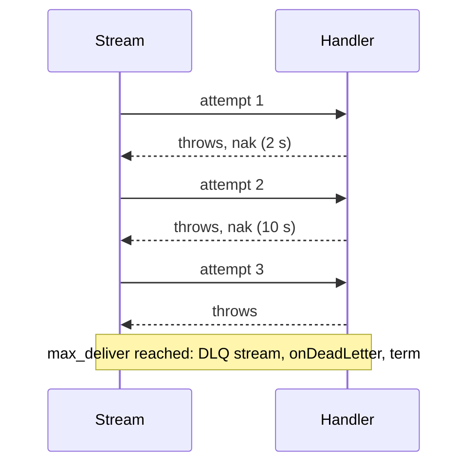

# Events (Workqueue)

> **Use when:** exactly one consumer instance should handle each message (background jobs, billing, anything that shouldn't run twice).
> **You get:** at-least-once delivery, retries on throw, and a dead-letter queue when retries run out.

A workqueue event goes to **one** handler instance, even with three replicas of the service running. It is the default for `@EventPattern`. For every instance to receive every message, use [broadcast](/docs/patterns/broadcast); for a strict replayable sequence, use [ordered events](/docs/patterns/ordered-events).

## How it works

1. **Publish**: a service calls `client.emit('order.created', data)`.
2. **Route**: the transport publishes to `{service}__microservice.ev.order.created`.
3. **Stream**: the message is stored in the service's event stream under workqueue retention.
4. **Consume**: the service's durable pull consumer hands it to one replica.
5. **Dispatch**: the router decodes the payload and calls the matching `@EventPattern` handler.
6. **Settle**: success acks the message, which deletes it from the stream. A throw naks it for redelivery.

Handlers run concurrently, bounded by the consumer's `max_ack_pending` and by `concurrency` when you set one (see [Performance Tuning](/docs/guides/performance#concurrency-control)).

## Sending and handling

`ClientProxy.emit()` with a bare pattern publishes a workqueue event:

```typescript title="src/orders/orders.service.ts"
import { Inject, Injectable } from '@nestjs/common';
import { ClientProxy } from '@nestjs/microservices';
import { lastValueFrom } from 'rxjs';

@Injectable()
export class OrdersService {
  constructor(@Inject('orders') private readonly client: ClientProxy) {}

  async createOrder(dto: CreateOrderDto): Promise<Order> {
    const order = await this.orderRepository.save(dto);

    await lastValueFrom(
      this.client.emit('order.created', { orderId: order.id, total: order.total }),
    );

    return order;
  }
}
```

`@EventPattern` without extras handles it. The return value is ignored, and a throw triggers a retry, so the handler needs no try/catch:

```typescript title="src/notifications/notifications.controller.ts"
import { Controller } from '@nestjs/common';
import { EventPattern, Payload } from '@nestjs/microservices';

@Controller()
export class NotificationsController {
  @EventPattern('order.created')
  async handleOrderCreated(@Payload() data: OrderCreatedEvent): Promise<void> {
    await this.emailService.sendOrderConfirmation(data);
  }
}
```

## One consumer per service

You do not name consumers per handler. Each service gets one durable consumer per stream kind, derived from the `name` in `forRoot()`: `name: 'orders'` gives `orders__microservice_ev-consumer`, shared by every workqueue handler in the service. Replicas pull from that one consumer, so JetStream hands each message to a single replica. The full list of generated names is in [Naming Conventions](/docs/reference/naming-conventions).

To give a subject its own consumer, move it to its own service. The second argument of `@EventPattern` is the only per-handler setting:

| Extra                | Effect                                                                                              |
| -------------------- | --------------------------------------------------------------------------------------------------- |
| `broadcast: true`    | Every service receives the message. See [Broadcast](/docs/patterns/broadcast).                      |
| `ordered: true`      | Strict sequential delivery. See [Ordered Events](/docs/patterns/ordered-events).                    |
| `schedule: { cron }` | Fires on a cron or interval. See [Recurring Schedules](/docs/guides/recurring-schedules).           |
| `meta: { ... }`      | Free-form data for the [handler metadata registry](/docs/patterns/handler-metadata).                |
| `connection: 'name'` | Binds the handler to a named connection. See [Multiple Connections](/docs/guides/multi-connection). |

There is no `durable`, `ackWait` or `maxDeliver` extra. Those are consumer settings, set once on the module (see [Configuration](#configuration)).

## Delivery semantics

Delivery is at-least-once with explicit acks:

| What happens                          | Result                                                                               |
| ------------------------------------- | ------------------------------------------------------------------------------------ |
| Handler resolves                      | `ack`, the message leaves the stream                                                 |
| Handler throws or calls `ctx.retry()` | `nak` with a delay, redelivered to any replica                                       |
| Handler calls `ctx.terminate()`       | `term`, no retry and no dead letter                                                  |
| Last attempt fails                    | Dead-lettered, then `term`                                                           |
| Payload cannot be decoded             | Dead-lettered at once (retrying cannot fix it), or `term` when dead-lettering is off |
| No handler for the subject            | Dead-lettered at once, or `term` when dead-lettering is off                          |

By default a message gets three attempts (`max_deliver: 3`), with redeliveries 2 s and then 10 s after a failure. The delay is applied by the client through `nak(delay)`, so `ack_wait` keeps its full value and a slow handler is not redelivered while it still runs. Change the curve with `events.retry` (see [module configuration](/docs/reference/module-configuration#retry)).



On the last failed attempt the message goes to the built-in DLQ stream (on unless you pass `dlq: false`) and to your `onDeadLetter` callback, if any. The [Dead Letter Queue](/docs/guides/dead-letter-queue) guide covers the fallback chain and what happens when a capture step fails.

## Retry or terminate

A throw means "try again". When you know a retry will fail the same way (a validation error, a broken business rule), call `ctx.terminate()` instead, so the message does not burn its remaining attempts:

```typescript title="src/orders/orders.controller.ts"
import { Controller } from '@nestjs/common';
import { Ctx, EventPattern, Payload } from '@nestjs/microservices';
import { RpcContext } from '@horizon-republic/nestjs-jetstream';

@Controller()
export class OrdersController {
  @EventPattern('order.process')
  async handleOrder(@Payload() data: OrderPayload, @Ctx() ctx: RpcContext): Promise<void> {
    try {
      await this.ordersService.process(data);
    } catch (error) {
      if (error instanceof ValidationError) {
        ctx.terminate(`Invalid order: ${error.message}`);

        return;
      }

      throw error; // DB timeout, API down: redelivered
    }
  }
}
```

A terminated message skips the dead-letter queue. `ctx.retry({ delayMs })` and the rest of the settlement API are in [Handler Context](/docs/guides/handler-context#controlling-message-settlement).

## Idempotency

At-least-once means a handler can see the same message twice, for example when the service crashes after processing but before the ack. Make handlers idempotent.

**Upsert** with a unique constraint, so a second run is a no-op:

```typescript
@EventPattern('order.created')
async handleOrderCreated(@Payload() data: OrderCreatedEvent): Promise<void> {
  await this.db.query(
    `INSERT INTO processed_orders (order_id, status) VALUES ($1, $2)
     ON CONFLICT (order_id) DO NOTHING`,
    [data.orderId, 'confirmed'],
  );
}
```

**Track processed messages** by stream sequence, which is unique within a stream:

```typescript
@EventPattern('payment.completed')
async handlePayment(@Payload() data: PaymentEvent, @Ctx() ctx: RpcContext): Promise<void> {
  const key = `payment:${ctx.getStream()}:${ctx.getSequence()}`;

  if (await this.cache.exists(key)) return;

  await this.processPayment(data);
  await this.cache.set(key, '1', { ttl: 86400 });
}
```

Duplicate _publishes_ (a publisher retrying after a timeout) are a separate problem: JetStream drops a second message with the same ID inside the stream's `duplicate_window`. The transport sets a random ID per publish, so set a deterministic one with [`setMessageId()`](/docs/guides/record-builder#message-id--jetstream-deduplication).

## Configuration

Stream and consumer settings live under `events` in `forRoot()`. These are the ones most often changed:

```typescript
import { toNanos } from '@horizon-republic/nestjs-jetstream';

JetstreamModule.forRoot({
  name: 'orders',
  servers: ['nats://localhost:4222'],
  events: {
    stream: {
      max_age: toNanos(14, 'days'),            // how long unprocessed events are kept
      duplicate_window: toNanos(5, 'minutes'), // dedup window for setMessageId()
    },
    consumer: {
      max_deliver: 5,                   // attempts before dead-lettering
      ack_wait: toNanos(30, 'seconds'), // time to finish before redelivery
      max_ack_pending: 50,              // in-flight cap, the main backpressure control
    },
    retry: [1_000, 5_000, 30_000],      // delay before each redelivery, in ms
    concurrency: 20,                    // handlers running at once
  },
});
```

- Raise `ack_wait` when a handler calls a slow external API. For work with no upper bound, use [ack extension](/docs/guides/performance#ack-extension) instead.
- Raise `max_deliver` when failures are transient and frequent, such as an unreliable third-party service.

Defaults for every field are in [Default Configs](/docs/reference/default-configs#stream-defaults), and the option reference is in [Module Configuration](/docs/reference/module-configuration).

## What's next?

- [Broadcast Events](/docs/patterns/broadcast): fan-out to every service
- [Dead Letter Queue](/docs/guides/dead-letter-queue): messages that exhaust their retries
- [Record Builder](/docs/guides/record-builder): headers and message IDs
- [Performance Tuning](/docs/guides/performance): concurrency, ack extension, backpressure
- [Troubleshooting](/docs/guides/troubleshooting#consumer-issues): delivery and redelivery problems
