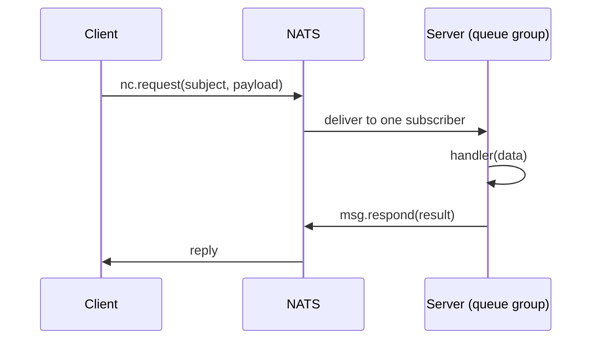
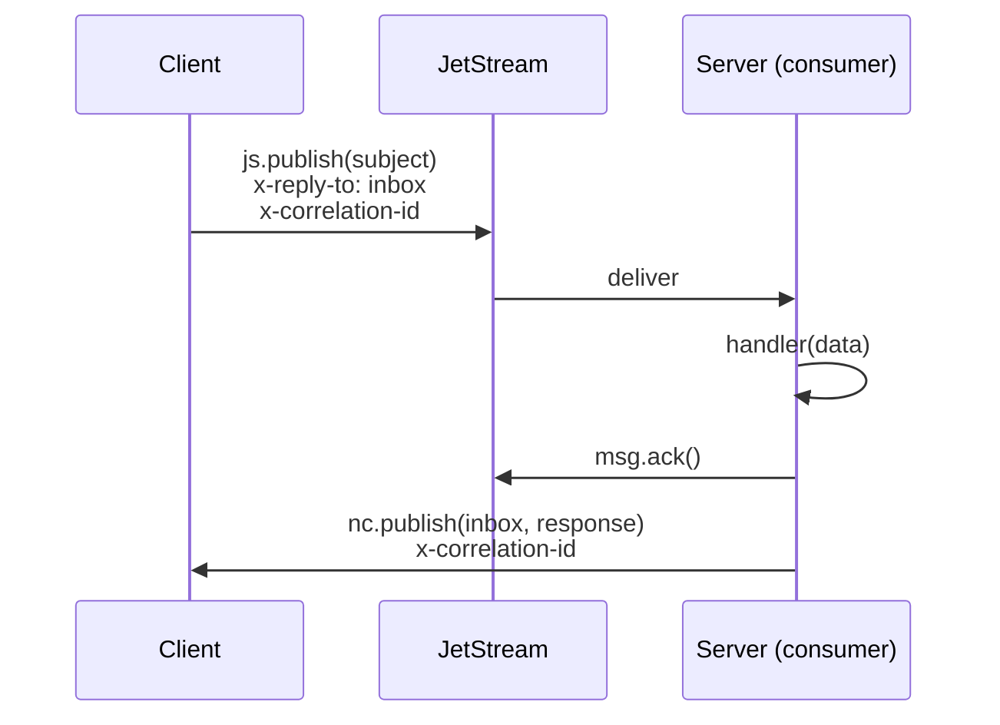

# RPC (Request/Reply)

> **Use when:** one service needs a response from another within a timeout window (queries, lookups, commands with results).
> **You pick:** **Core** mode for sub-millisecond replies, **JetStream** mode for commands that must survive a restart. Same `@MessagePattern` either way.

The client sends a request and waits for the reply inside a timeout. The application code is the same in both modes; only `rpc.mode` in `forRoot()` changes.

## Sending and handling

```typescript title="src/gateway/gateway.service.ts"
import { Inject, Injectable } from '@nestjs/common';
import { ClientProxy } from '@nestjs/microservices';
import { firstValueFrom } from 'rxjs';

@Injectable()
export class GatewayService {
  constructor(@Inject('orders') private readonly ordersClient: ClientProxy) {}

  getOrder(id: string): Promise<Order> {
    return firstValueFrom(this.ordersClient.send<Order>('get.order', { id }));
  }
}
```

```typescript title="src/orders/orders.controller.ts"
import { Controller } from '@nestjs/common';
import { MessagePattern, Payload } from '@nestjs/microservices';

@Controller()
export class OrdersController {
  @MessagePattern('get.order')
  handleGetOrder(@Payload() data: { id: string }): Promise<Order> {
    return this.ordersService.findById(data.id);
  }
}
```

A handler can return a plain value, a `Promise`, or an `Observable`. For an `Observable` the first emitted value becomes the reply (see [Observable return values](/docs/reference/edge-cases#observable-return-values-in-handlers)).

## Core mode (default)

Core mode uses NATS request/reply directly, with nothing persisted. It applies when `rpc` is unset or `rpc.mode` is `'core'`.

1. The client calls `nc.request(subject, payload, { timeout })`.
2. NATS routes the request to **one** server instance through a queue group, which load-balances across replicas.
3. The handler runs and the server answers with `msg.respond(result)`.
4. The reply arrives on a temporary inbox managed by NATS.



If no server instance is subscribed, the request fails at once with a NATS `no responders` error instead of waiting out the timeout.

## JetStream mode

JetStream mode stores the command in a stream before delivery, so it survives a server restart. The reply still travels over Core NATS.

```typescript
JetstreamModule.forRoot({
  name: 'orders',
  servers: ['nats://localhost:4222'],
  rpc: { mode: 'jetstream' },
});
```

1. The client generates a correlation ID and registers a pending callback.
2. It publishes the command with `js.publish()`, carrying the correlation ID and its inbox subject in the `x-correlation-id` and `x-reply-to` headers.
3. The server's command consumer delivers the message to the handler.
4. On success the server acks the message, then publishes the result to the client's inbox with `nc.publish()`.
5. The client matches the correlation ID and resolves the callback.



A command is never redelivered: a failing handler terminates the message (`term`) and the error goes back to the caller. Retrying a command behind the caller's back could, for example, charge a card twice.

If the server is down, the command waits in the stream and runs when a server starts. When the client's timeout expires first, the client gets a timeout error, yet the handler may still run later and publish a reply nobody listens to. Make such handlers idempotent.

## Core or JetStream

| Aspect               | Core mode                              | JetStream mode                                           |
| -------------------- | -------------------------------------- | -------------------------------------------------------- |
| **Latency**          | Lowest, direct request/reply           | Slightly higher: stream write plus inbox routing         |
| **Persistence**      | None                                   | Command stored in a stream before delivery               |
| **Server offline**   | Immediate `no responders` error        | Command waits in the stream until a server starts        |
| **Retry on failure** | None                                   | None (`max_deliver: 1`), error returned to the caller    |
| **Default timeout**  | 30 seconds                             | 3 minutes                                                |
| **Load balancing**   | NATS queue group                       | JetStream consumer, one delivery                         |
| **Use case**         | Low-latency queries, real-time lookups | Commands that must not be lost (payments, state changes) |

Start with Core mode. Switch to JetStream mode when a command must survive a server restart without the client seeing an error.

## Errors

The handler's error reaches the caller as the rejection of `send()`, flagged by the `x-error` header. How the error is serialized depends on what you throw:

```typescript
// RpcException: the full payload from getError()
throw new RpcException({ code: 'NOT_FOUND', message: 'Order not found' });
// caller receives { code: 'NOT_FOUND', message: 'Order not found' }

// Error: only the message
throw new Error('Something went wrong');
// caller receives { message: 'Something went wrong' }

// Plain object: passed through as-is
throw { code: 'VALIDATION_ERROR', fields: ['email'] };
// caller receives { code: 'VALIDATION_ERROR', fields: ['email'] }
```

:::warning
Prefer `RpcException`. A generic `Error` loses everything except `message`, including status codes and validation details.
:::

Failures that never reach the handler behave differently per mode:

| Failure                                           | Core mode                               | JetStream mode               |
| ------------------------------------------------- | --------------------------------------- | ---------------------------- |
| No handler for the subject                        | Error reply sent at once                | `term`, the client times out |
| Payload cannot be decoded                         | Error reply, handler not called         | `term`, the client times out |
| `x-reply-to` or `x-correlation-id` header missing | n/a                                     | `term`, the client times out |
| Handler exceeds `rpc.timeout`                     | Client times out, handler keeps running | `term`, no reply published   |

In JetStream mode, if the handler succeeds but the reply cannot be published, the message stays acked and the client times out.

NestJS exception filters work as usual. A filter that returns an `Observable`, for example through `throwError()`, is unwrapped by the transport:

```typescript
import { Catch, RpcExceptionFilter } from '@nestjs/common';
import { RpcException } from '@nestjs/microservices';
import { Observable, throwError } from 'rxjs';

@Catch(RpcException)
export class CustomRpcFilter implements RpcExceptionFilter<RpcException> {
  catch(exception: RpcException): Observable<never> {
    return throwError(() => exception);
  }
}
```

## Timeouts

`rpc.timeout` sets both sides of the call:

- **Client**: how long `send()` waits before rejecting.
- **Server, JetStream mode only**: how long the handler has before the message is terminated.

It defaults to 30 seconds in Core mode and 3 minutes in JetStream mode.

```typescript
JetstreamModule.forRoot({
  name: 'orders',
  servers: ['nats://localhost:4222'],
  rpc: { mode: 'jetstream', timeout: 60_000 },
});
```

In JetStream mode the handler result and the timeout race, and whichever comes first settles the message. The other is ignored, so the client never receives two replies.

For a single call, [`setTimeout()`](/docs/guides/record-builder#per-request-timeout-override) on the record builder overrides the client-side wait:

```typescript
const record = new JetstreamRecordBuilder({ id: orderId }).setTimeout(5_000).build();
const order = await firstValueFrom(this.ordersClient.send<Order>('get.order', record));
```

:::note
The per-request value only changes how long the client waits. In JetStream mode the server still enforces the module-level `rpc.timeout`.
:::

## Connection lost

A short disconnect does not fail pending calls. In JetStream mode the command is already stored in the stream and runs once the handler's connection is back, and NATS resubscribes the reply inbox after the reconnect, so the reply still reaches the caller. Failing those calls early would make a caller that retries on error run the command twice. Each call stays bounded by its timeout instead. In Core mode a pending `nc.request()` also waits for its timeout.

This protects only calls whose command was published before the connection dropped. A JetStream-mode call made during the disconnect buffers its publish: if the publish ack times out, the caller gets an error, but the buffered command is still sent after the reconnect and runs. A caller that retries on that error can still run the command twice, so give a retried command the same `messageId`: the stream then drops the copy and the retry fails with `duplicate-publish` instead of running the command again.

A connection that closes for good, for example once `maxReconnectAttempts` runs out, is different. In JetStream mode every pending call fails at once with `connection-lost`, the client drops its inbox, and the next call dials a new connection and opens a new inbox. In Core mode NATS rejects pending `nc.request()` calls itself.

In JetStream mode, unsubscribing from `send()` before it settles, through `timeout()` or `takeUntil()` for example, abandons the call: the `RpcClientSend` span ends with an `rpc.cancelled` event and `RpcCompleted` reports `cancelled`. A command that was already published still runs; only its reply is ignored. In Core mode the request runs on after an unsubscribe, and the span and `RpcCompleted` report its real outcome, `success` or `timeout`.

## See also

- [Record Builder](/docs/guides/record-builder): headers, message IDs, per-request timeouts
- [Module Configuration](/docs/reference/module-configuration): every `rpc` option
- [Performance Tuning](/docs/guides/performance): concurrency and ack extension for JetStream RPC
- [Troubleshooting](/docs/guides/troubleshooting#rpc-issues): timeout and routing errors
